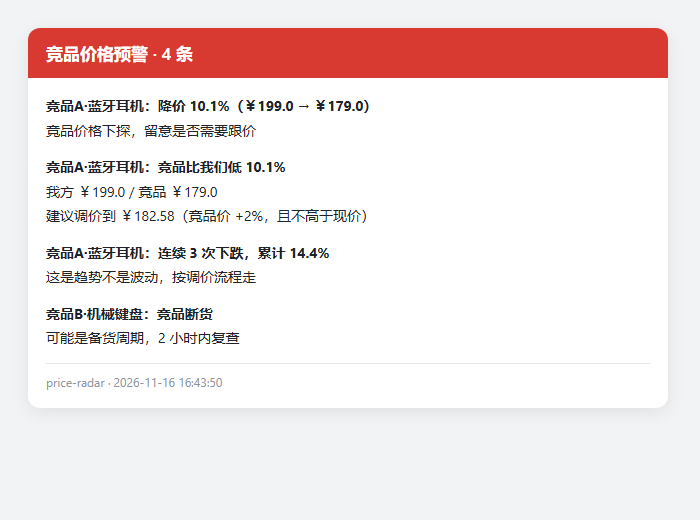

# price-radar · 竞品价格监控 → 飞书告警

> 定时抓竞品商品页的价格与库存，按阈值判定「降价 / 涨价 / 断货 / 补货 / 被压价 / 连续下跌」，
> 合成一张飞书卡片推到群里，并给出跟价建议。纯 Python + SQLite，单文件数据库，无需任何中间件。




---

## 30 秒看懂它解决什么

跨境电商 / 电商运营每天要盯几十个竞品链接：**谁降价了、谁断货了、我要不要跟价**。
人工刷新既慢又漏。这个工具把「盯页面 → 比上次 → 判断要不要吵人 → 给建议 → 推群」做成一圈，
默认每 2 小时跑一次，只有真的值得看的才发消息。

---

## 5 分钟跑起来（不联网，先看效果）

```bash
git clone https://github.com/Se7en-exe/price-radar.git
cd price-radar
python -m pip install -r requirements.txt

python -m price_radar demo          # 用内置 fixtures 造 3 天历史，跑通全链路（干跑，不推）
```

真实输出（本机实测）：

```text
  竞品A·蓝牙耳机       ￥179.0     有货=True  通过=css:.price
  竞品B·机械键盘       ￥1288.0    有货=False 通过=css:.price
无告警

判定结果:
  [drop] 竞品A·蓝牙耳机：降价 10.1%（￥199.0 → ￥179.0）
  [undercut] 竞品A·蓝牙耳机：竞品比我们低 10.1%
        我方 ￥199.0 / 竞品 ￥179.0
        建议调价到 ￥182.58（竞品价 +2%，且不高于现价）
  [sustained] 竞品A·蓝牙耳机：连续 3 次下跌，累计 14.4%
  [oos] 竞品B·机械键盘：竞品断货
```

---

## 接到你自己的飞书（3 步）

1. **建机器人**：飞书里进任意群 → 右上角 `···` → 设置 → 群机器人 → 添加机器人 → **自定义机器人** → 复制 **Webhook 地址**（勾了「签名校验」就把密钥一起留下）
2. **填地址**（二选一）
   - 环境变量（推荐，避免误提交）：`export FEISHU_WEBHOOK="https://open.feishu.cn/open-apis/bot/v2/hook/xxx"`
   - 或写进 `config.json` 的 `feishu.webhook`
3. **跑一轮**

```bash
cp config.example.json config.json     # 改成你要监控的商品
python -m price_radar run              # 单轮：抓 → 判 → 推
```

推成功会打印 `推送: OK`，飞书群里出现一张卡片；失败会打印飞书返回的错误码（`19021` = 签名不对）。

---

## 常驻运行（三种方式，任选）

```bash
# 1) 自带循环，带 ±10% 抖动，Ctrl-C 干净退出，日志写 out/price_radar.log
python -m price_radar watch --interval 7200

# 2) Docker（推荐服务器）
cp config.example.json config.json
echo "FEISHU_WEBHOOK=https://open.feishu.cn/open-apis/bot/v2/hook/xxx" > .env
docker compose up -d

# 3) Windows 计划任务
schtasks /create /tn "price-radar" /sc hourly /mo 2 ^
  /tr "cmd /c cd /d C:\path\to\price-radar && python -m price_radar run"
```

Linux cron 同理：`0 */2 * * * cd /opt/price-radar && /usr/bin/python3 -m price_radar run`。

---

## 配置：一个 config.json 说清全部

```json
{
  "feishu":  { "webhook": "", "secret": "", "dry_run": false },
  "rules":   { "drop_pct": 5.0, "rise_pct": 5.0, "undercut_pct": 8.0,
               "margin": 0.02, "sustained_n": 3, "dedupe_hours": 24 },
  "interval_seconds": 7200,
  "db": "data/price.sqlite",
  "products": [
    { "name": "竞品A·蓝牙耳机", "url": "https://example.com/item/1",
      "selector": ".price", "our_price": 199, "enabled": true }
  ]
}
```

| 字段 | 作用 |
|---|---|
| `products[].url` | 商品页地址，**也支持本地 html 路径**（便于离线演示/测试） |
| `products[].selector` | 价格所在的 CSS 选择器；留空则走自动降级 |
| `products[].our_price` | 我方售价，用来算「被压价」与跟价建议 |
| `rules.drop_pct` / `rise_pct` | 涨跌幅超过多少才告警（默认 5%） |
| `rules.undercut_pct` | 竞品比我方低多少算压价（默认 8%） |
| `rules.margin` | 建议价 = 竞品价 × (1 + margin)，且不高于我方现价 |
| `rules.sustained_n` | 连续 N 次下跌也算信号（趋势 ≠ 波动） |
| `rules.dedupe_hours` | 同一商品同一类告警 N 小时内不重复发（抓取失败除外） |

优先级：**命令行参数 > 环境变量 > config.json > 内置默认值**。

---

## 取价策略：四级降级，尽量不求人

| 顺序 | 方式 | 适用 | 输出里的 `通过=` |
|---|---|---|---|
| 1 | CSS 选择器 | 页面结构稳定 | `css:.price` |
| 2 | `meta[itemprop=price]` | 电商站常见，抗改版 | `meta[itemprop=price]` |
| 3 | JSON-LD `offers.price` | 结构化数据完整的站 | `json-ld` |
| 4 | 整页正则 `¥ / ￥ / $` | 兜底 | `regex` |
| + | Playwright 渲染 | 前端渲染页（`--browser`） | `...+browser` |

库存判断：正文命中「无货 / 售罄 / 缺货 / 下架 / sold out / out of stock」即视为断货。

---

## 判定规则与卡片

| 告警 kind | 触发条件 | 卡片等级 | 文案要点 |
|---|---|---|---|
| `first` | 首次采集 | blue | 建立基线，不算变化 |
| `drop` | 跌幅 ≥ `drop_pct` | red | 差价 + 是否跟价 |
| `rise` | 涨幅 ≥ `rise_pct` | orange | 我方有提价空间 |
| `oos` / `restock` | 有货 ↔ 断货 | red / blue | 备货周期提示 |
| `undercut` | 竞品低于我方 ≥ `undercut_pct` | red | **给出建议价**：min(竞品×(1+margin), 我方现价) |
| `sustained` | 连续 `sustained_n` 次下跌 | red | 这是趋势不是波动 |
| `miss` | 没抓到价格 | orange | 选择器失效/页面改版，每轮都提醒 |

一轮里所有商品的告警**合并成一张卡片**推一次，避免刷屏。

---

## 架构

```text
config.json ──┐
              ▼
        runner.crawl_all()                ┌── SQLite: product / snapshot / alert
              │                           │    last_snapshot() 按 (ts DESC, id DESC)
   ┌──────────┼───────────┐               │    has_recent_alert() 做去重
   ▼          ▼           ▼               │
fetch.py   rules.py   notify.py  ─────────┘
(四级降级)  (阈值判定)  (飞书卡片/签名/重试)
   │          │           │
   ▼          ▼           ▼
 商品页    上次快照     飞书群
```

模块职责：`fetch` 只负责「从 HTML 里拿到价格」，无状态；`rules` 只做纯函数判定（所以能 100% 单测）；
`store` 只管落库；`notify` 只管推送；`runner` 把四者串起来，单个商品异常不中断整轮。

---

## 测试

```bash
python -m pip install -r requirements-dev.txt
python -m pytest -q
# 25 passed
```

覆盖：四级取价降级、库存词判断、五类阈值边界、跟价建议算法、同秒插入的取最新回归、告警去重窗口、
飞书签名参考向量（HMAC 结果写死对照）、干跑不发请求、配置合并与环境变量覆盖、幂等入库。
想开 GitHub Actions：把 docs/ci.yml.example 复制到 .github/workflows/ci.yml 再提交（推送 workflow 文件需要 token 带 workflow 权限，或直接在网页上新建）。

---

## 已知边界（先说清楚，免得失望）

- **只做公开页面的低频抓取**：默认 2 小时一次 + 抖动，不做高频轮询
- **需要登录 / 有验证码 / 强风控的站点不支持**，这不是打码工具
- 前端渲染页要 `pip install -r requirements-browser.txt` 再 `python -m playwright install chromium`，并加 `--browser`
- **不保证任何具体站点的结构**：页面改版就改 `selector`，抓不到会发 `miss` 告警提醒你
- SQLite 单机单写，多进程同时写同一库会锁表；要多机就换 PostgreSQL（改动集中在 `store.py`）
- 飞书群机器人自身有频率限制（每分钟 100 条），本项目一轮只发一张卡，正常用不会撞

---

## 目录

```text
price_radar/   fetch.py rules.py store.py notify.py runner.py config.py cli.py
fixtures/      两个离线样例页（有货降价 / 断货）
tests/         25 个用例
n8n/           可选：n8n 可视化编排（定时 → HTTP → 取价 → 判定 → 推飞书）
tools/         mock_feishu.py（本地假 webhook）、send_test.py（连通性测试）
docs/          卡片预览、面试口径
```

## English

Competitor price monitor for e-commerce ops: scrapes product pages on a schedule, diffs against the last
snapshot, applies threshold rules (drop / rise / out-of-stock / undercut / sustained downtrend) and pushes a
single Feishu (Lark) interactive card with a suggested price. Pure Python, SQLite, no message queue.

```bash
pip install -r requirements.txt
python -m price_radar demo                       # offline end-to-end demo
export FEISHU_WEBHOOK="https://open.feishu.cn/open-apis/bot/v2/hook/xxx"
python -m price_radar run                        # one pass
python -m price_radar watch --interval 7200      # daemon
```

## License

MIT © Se7en-exe
